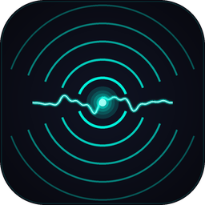
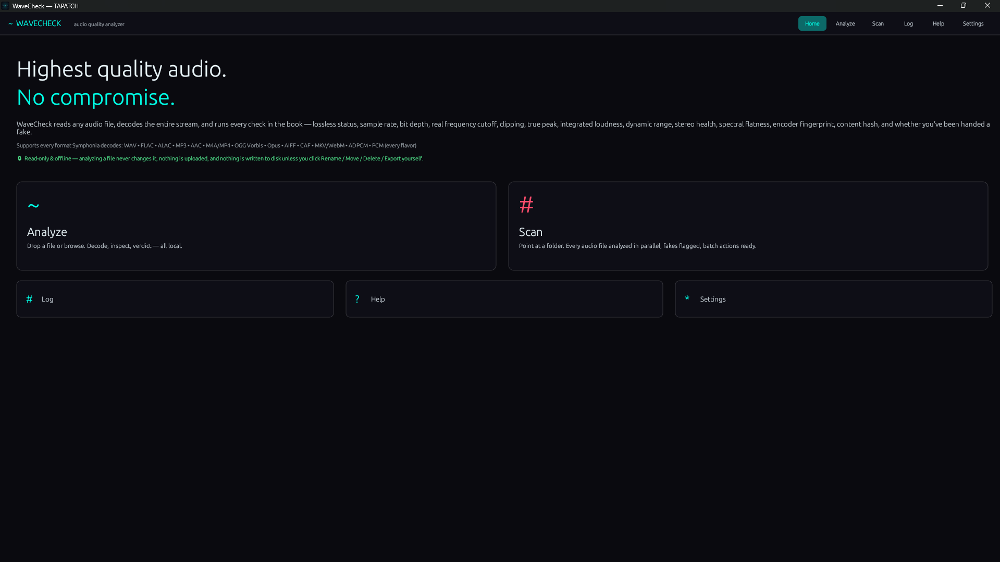
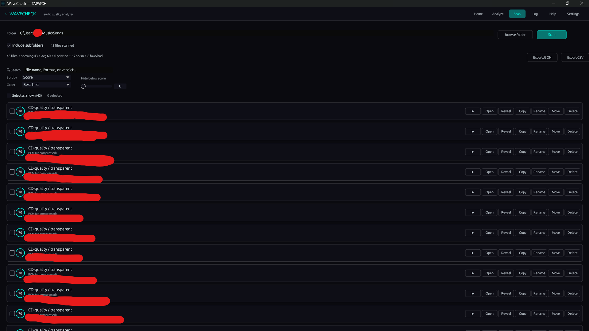
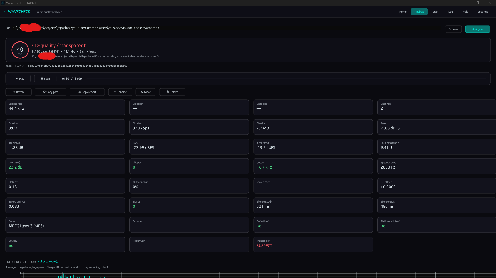
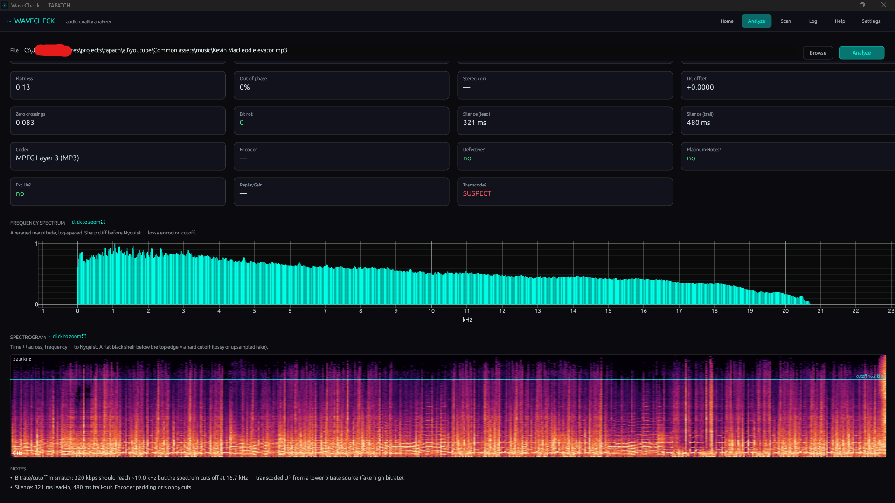

<p align="center"></p>
<h1 align="center">WaveCheck</h1>
<p align="center"><b>Catches fake lossless. Research-grade, fully offline.</b></p>
<p align="center">Audio Quality Analyzer · Windows 10/11 · x64 · ~7 MB · Free for personal use</p>
<p align="center"><a href="https://github.com/tapatchUSA/WaveCheck/releases/latest"><b>⬇ Download WaveCheck 1.0.3</b></a> &nbsp;·&nbsp; <a href="https://tapatch.com/tools/wavecheck/">tapatch.com/tools/wavecheck</a></p>

<p align="center">
<br>
 <br>

</p>

> Built because every 'lossless' library hides upscaled fakes — and the tools that catch them either upload your music or charge for it. WaveCheck does neither.

## What it does

WaveCheck is a forensic audio quality analyzer for Windows. It decodes a file in pure Rust (no FFmpeg), measures it to broadcast spec, and tells you at a glance whether it's a genuine master or an upscaled fake. Spectral-cutoff-vs-Nyquist detection exposes MP3s renamed to FLAC; ITU-R BS.1770-4 / EBU R128 loudness, 4× oversampled true-peak, bit-depth utilisation, stereo correlation, and an STFT spectrogram fill in the full forensic picture. Scan a whole library in parallel, sort and search the results, then triage with rubber-band select and bulk move / delete. Everything runs 100% offline — your audio never leaves the machine, and analysis never modifies a file.

## Features

Packed with research-grade DSP. Here are the highlights.

**🕵️ Fake-lossless detector**  
Maps the real spectral cutoff against Nyquist. A FLAC that dies at 16 kHz is an upsampled MP3 — flagged with a 'lossless masquerade' note. Catches the renames every fake library is full of.

**📊 Spectrum + spectrogram**  
A 2048-pt Hann FFT spectrum plus a full STFT heatmap. Click either to blow it up full-window with drag-to-pan and scroll-to-zoom. The flat black shelf above a cutoff is unmistakable.

**🔊 Broadcast loudness**  
ITU-R BS.1770-4 K-weighting and EBU R128 integrated LUFS + loudness range, locked to the libebur128 reference coefficients. Per-channel, surround-aware, LFE-excluded.

**📈 4× true-peak**  
Polyphase Kaiser-windowed-sinc oversampling catches inter-sample peaks that clip a DAC even when the raw sample peak reads under 0 dBFS.

**🧬 Forensic fingerprints**  
Real bit-depth utilisation vs declared, per-window L/R correlation, DC offset, clipping, bit-rot, and an audio SHA-256 that ignores container repacks and tag edits.

**🗂️ Parallel folder scan**  
Rayon-parallel scan of a whole library. Sort by any of 15 fields, search by name / format / verdict, rubber-band select, and bulk move / delete or export to CSV / JSON.

**🎚️ DSD + every common format**  
WAV / AIFF / CAF, FLAC / ALAC, MP3 / AAC / Vorbis / Opus, Matroska — plus pure-Rust DSD (.dsf / .dff) decoding. No FFmpeg, no external runtime.

**🔒 100% offline + read-only**  
No network, no telemetry, no uploads. Analysis opens every file read-only and throws the samples away when done — it never alters the file you point it at.

## Limitations

- Patent-encumbered and niche formats with no production-quality pure-Rust decoder are detected and reported rather than guessed at — WMA, Musepack, Monkey's Audio (APE), TTA, WavPack, MPEG-4 ALS, and DST-compressed DSD. Transcode those to FLAC or WAV to analyze them. DSD (.dsf / .dff) decoding is verified against generated test signals; sanity-check the first few real files against a known-good source.

## What's new in 1.0.3

- Now in 10 languages: English, Chinese (Simplified), Russian, Spanish, Portuguese, German, Japanese, French, Polish and Korean
- Starts in your Windows language (English if yours isn't one of the 10). The first launch asks which language you want, and you can switch any time inside the app
- The installer comes in the same 10 languages
- The Terms of Service are shown translated for convenience, with the official English (US) text, the only binding version, right below

Release notes for every version are on the [Releases](https://github.com/tapatchUSA/WaveCheck/releases) page and in [release-notes/](release-notes/).

## Install

1. Download **WaveCheck-Setup-1.0.3.exe** from the [latest release](https://github.com/tapatchUSA/WaveCheck/releases/latest) or from [tapatch.com](https://tapatch.com/tools/wavecheck/).
2. Run it. The installer and the app come in 10 languages.
3. Accept the Terms of Service on first launch.

Windows may show a SmartScreen warning for new downloads. Click **More info → Run anyway**.

Or with [Scoop](https://scoop.sh):

```powershell
scoop bucket add tapatch https://github.com/tapatchUSA/packages
scoop install tapatch/wavecheck
```

## All versions

| Version | Released | Installer | VirusTotal | SHA-256 |
|---|---|---|---|---|
| [1.0.3](https://github.com/tapatchUSA/WaveCheck/releases/tag/v1.0.3) | 2026-10-01 | [WaveCheck-Setup-1.0.3.exe](https://github.com/tapatchUSA/WaveCheck/releases/download/v1.0.3/WaveCheck-Setup-1.0.3.exe) | [1 / 71](https://www.virustotal.com/gui/file/66645d64c5d16cf30958ee5b8600eb72a08ef4a6bf4182376f4b45b9fc005c54/detection) | `66645d64c5d16cf3…` |
| [1.0.2](https://github.com/tapatchUSA/WaveCheck/releases/tag/v1.0.2) | 2026-09-30 | [WaveCheck-Setup-1.0.2.exe](https://github.com/tapatchUSA/WaveCheck/releases/download/v1.0.2/WaveCheck-Setup-1.0.2.exe) | [2 / 69](https://www.virustotal.com/gui/file/2743474b0d380cbabcb0cab6e8fb49e2a488b17cb8f5fb4ba8884672680fd0b7/detection) | `2743474b0d380cba…` |
| [1.0.1](https://github.com/tapatchUSA/WaveCheck/releases/tag/v1.0.1) | 2026-09-20 | [WaveCheck-Setup-1.0.1.exe](https://github.com/tapatchUSA/WaveCheck/releases/download/v1.0.1/WaveCheck-Setup-1.0.1.exe) | [2 / 70](https://www.virustotal.com/gui/file/039331b36e71d9360f781418af706a6386757f0a3c9a3e2547e091b2cf3f6a5e/detection) | `039331b36e71d936…` |
| [1.0.0](https://github.com/tapatchUSA/WaveCheck/releases/tag/v1.0.0) | 2026-09-16 | [WaveCheck-Setup-1.0.0.exe](https://github.com/tapatchUSA/WaveCheck/releases/download/v1.0.0/WaveCheck-Setup-1.0.0.exe) | [2 / 71](https://www.virustotal.com/gui/file/790513c90cd98609ad9992e6d810ea08f6287e22d6cad7523447adabf86c067a/detection) | `790513c90cd98609…` |

## Security

Every installer is scanned on VirusTotal before release. WaveCheck 1.0.3: **1 / 71** engines flag it · [view report](https://www.virustotal.com/gui/file/66645d64c5d16cf30958ee5b8600eb72a08ef4a6bf4182376f4b45b9fc005c54/detection)

**SHA-256**
```
66645d64c5d16cf30958ee5b8600eb72a08ef4a6bf4182376f4b45b9fc005c54
```

## Built with

Rust · egui · eframe · Symphonia · rustfft · rayon

## License

Free for personal use. Business or commercial use requires a paid license (see [tapatch.com/terms](https://tapatch.com/terms/)). Full terms: [tapatch.com/terms/software](https://tapatch.com/terms/software/).

This repository holds the official installers and release notes.

---

**[tapatch.com](https://tapatch.com)**: small tools, serious quality. Built solo, shipped with care.
