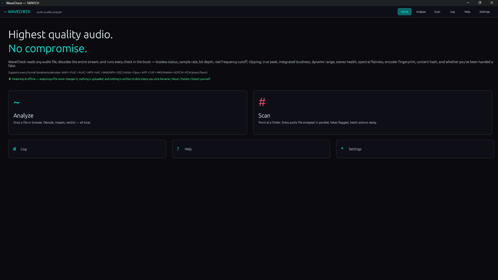
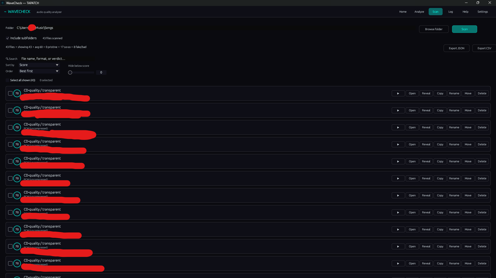
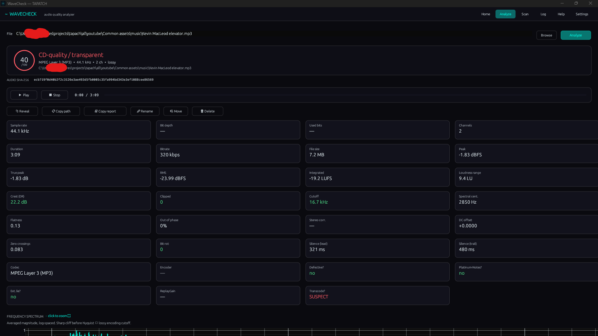
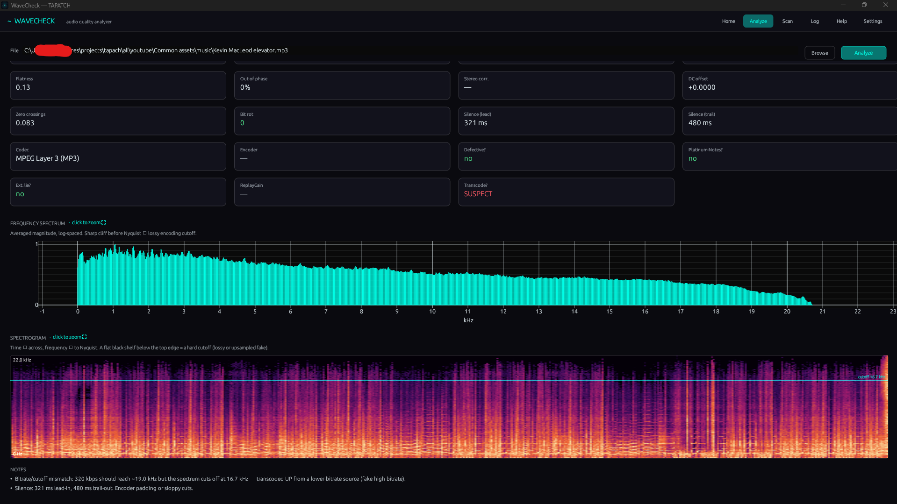

**WaveCheck 1.0.5** for Windows 10/11 (x64) · Free for personal use

### What's new

- Background pictures and GIFs: add as many as you like in Settings, tick the ones to show (or Select all), and the ticked ones take turns
- Sliders set how strong the picture is and how see-through the panels are; turn it off any time
- The installer's license text matches the current Terms, and THIRD-PARTY-NOTICES.txt lists the open-source parts it uses

### Screenshots

 
  

### Download

**`WaveCheck-Setup-1.0.5.exe`** is attached below. It is the same file as on [tapatch.com/tools/wavecheck](https://tapatch.com/tools/wavecheck/).

### Security

- VirusTotal: **1 / 71** engines flag it · [view report](https://www.virustotal.com/gui/file/aa50e1d19cbe3ab6834bd3c83700f3e7fd6321515ce3a0b39485d858aadfae6d/detection)
- SHA-256: `aa50e1d19cbe3ab6834bd3c83700f3e7fd6321515ce3a0b39485d858aadfae6d`

*First released on tapatch.com on 2026-11-05.*

---
Free for personal use. Business or commercial use requires a paid license (see [tapatch.com/terms](https://tapatch.com/terms/)).
