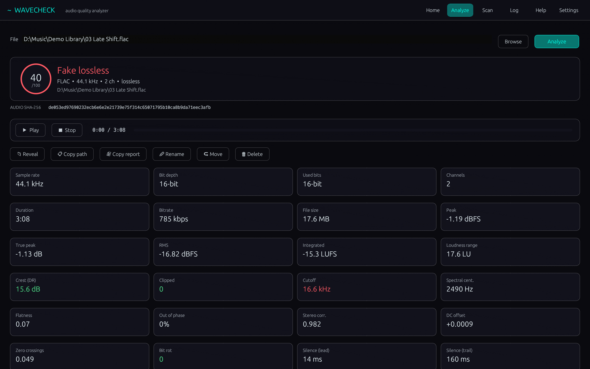
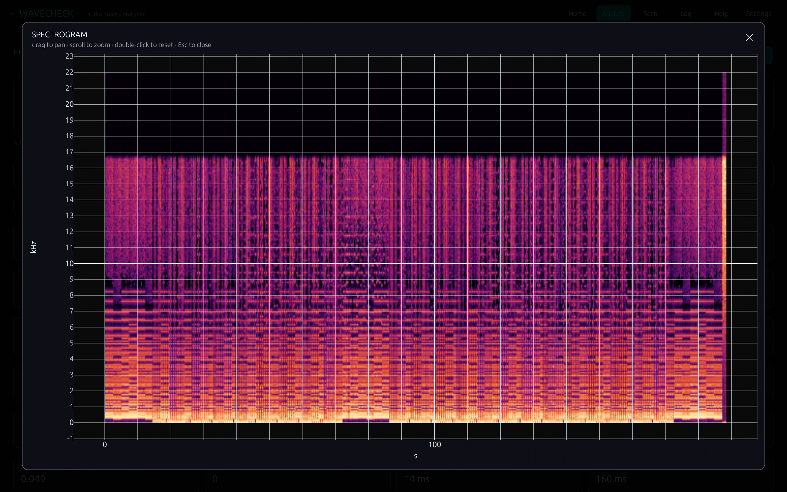
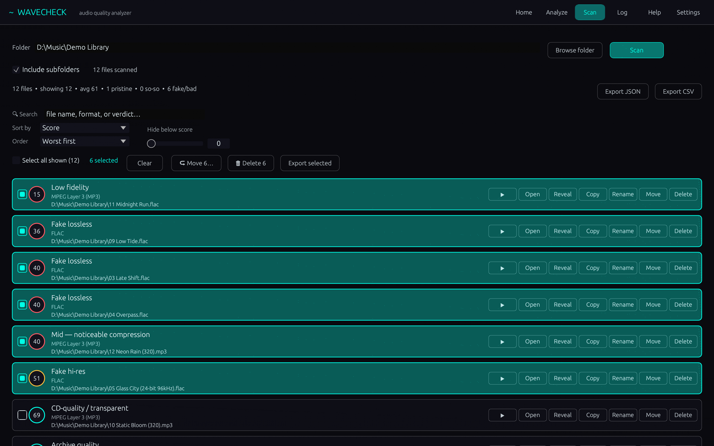
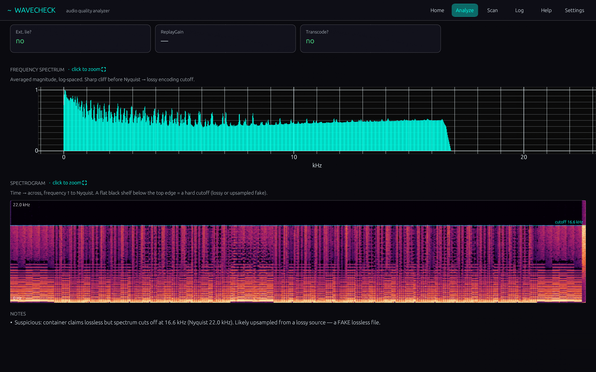
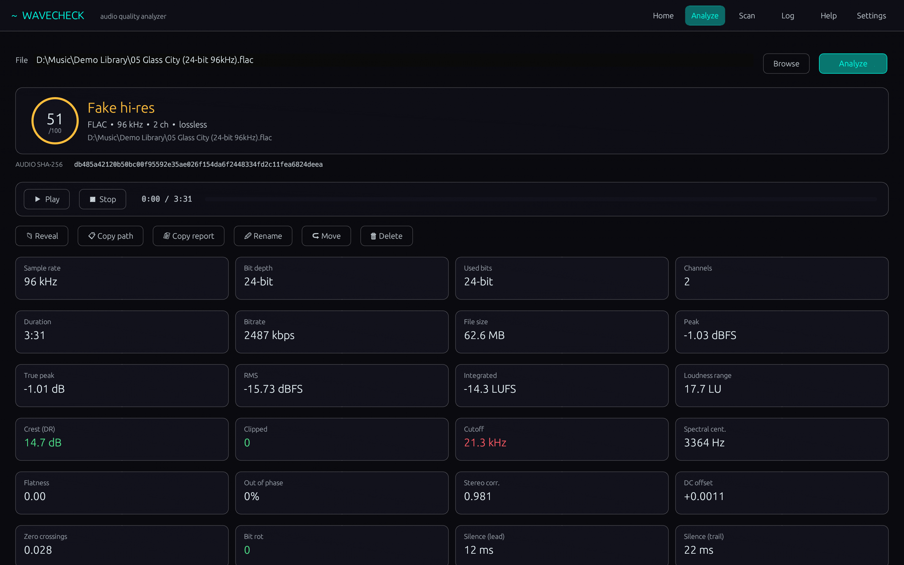
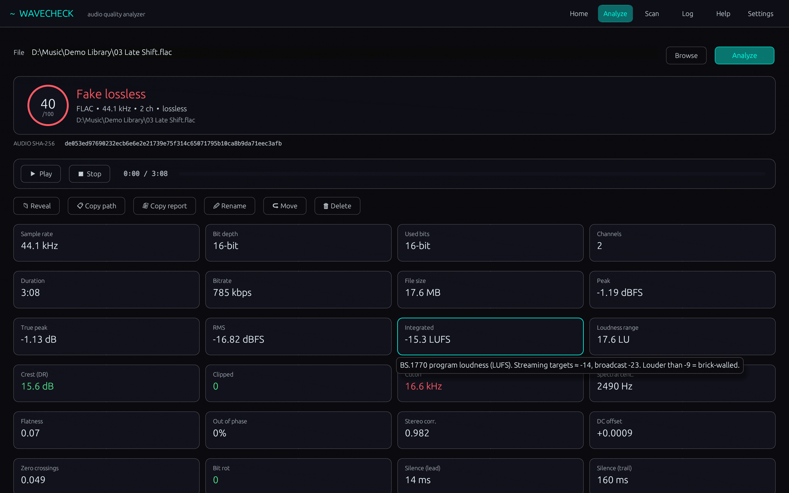
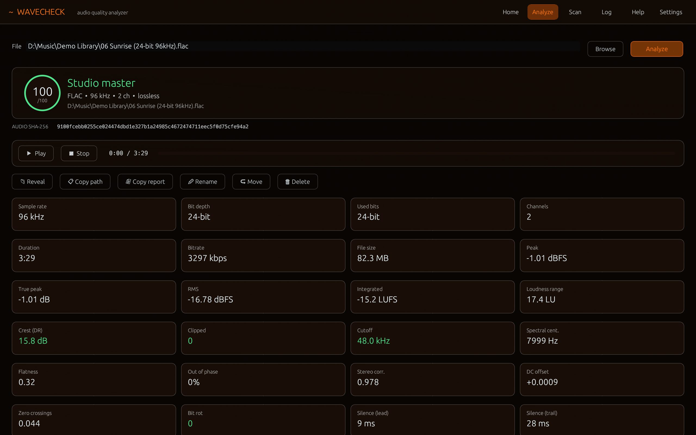
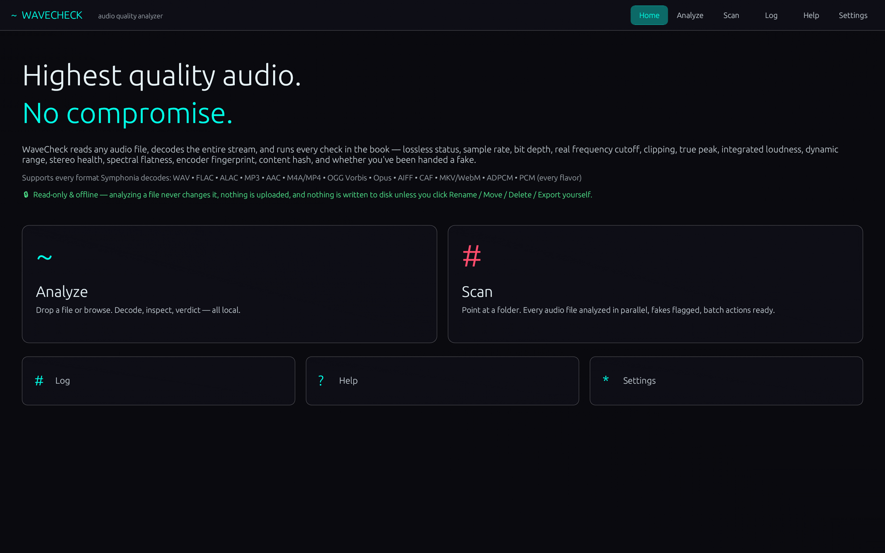

**WaveCheck 1.0.6** for Windows 10/11 (x64) · Free for personal use

### What's new

- A lossless file made from an MP3 or AAC now gets the verdict "Fake lossless" and loses 30 points, so it ranks below an honest MP3
- A hi-res file upsampled from CD quality now gets the verdict "Fake hi-res" and loses 25 points
- Folder scans count every fake in the "fake/bad" total, and CSV and JSON exports have fake_lossless and fake_hires columns
- The zoomed spectrogram shows time in seconds and frequency in kHz with the cutoff line, and the arrows in the chart notes no longer show as boxes

### Screenshots

 
  
  
  

### Download

**`WaveCheck-Setup-1.0.6.exe`** is attached below. It is the same file as on [tapatch.com/tools/wavecheck](https://tapatch.com/tools/wavecheck/).

### Security

- VirusTotal: **1 / 71** engines flag it · [view report](https://www.virustotal.com/gui/file/d1122e62f069da1b6828474053ae17f565b58a16e07a16e4fb208ed05fc8c8be/detection)
- SHA-256: `d1122e62f069da1b6828474053ae17f565b58a16e07a16e4fb208ed05fc8c8be`

*First released on tapatch.com on 2026-11-07.*

---
Free for personal use. Business or commercial use requires a paid license (see [tapatch.com/terms](https://tapatch.com/terms/)).
