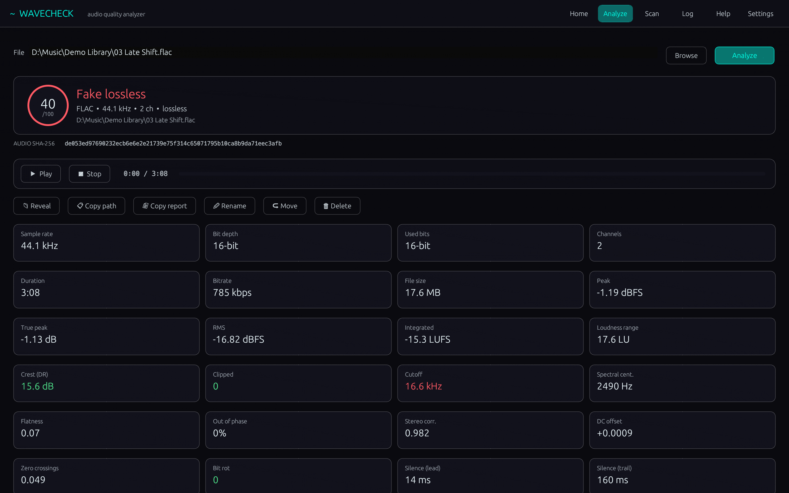
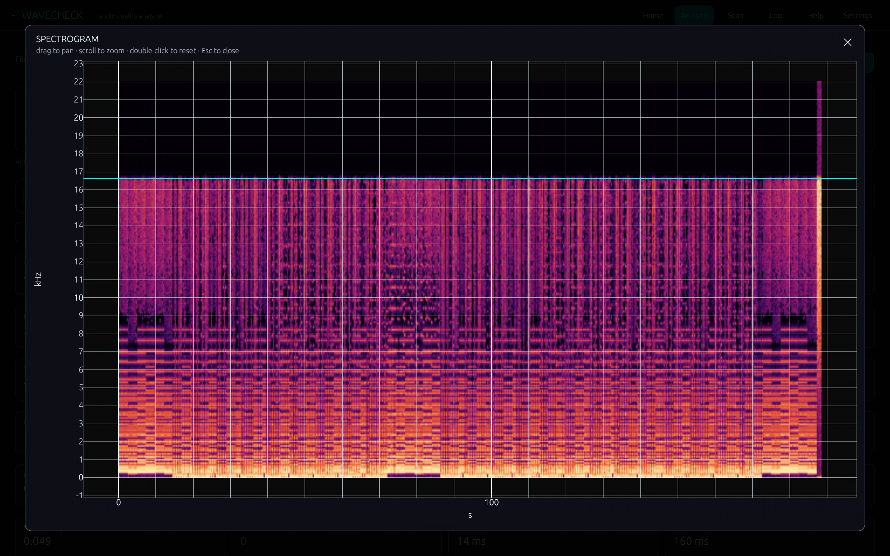
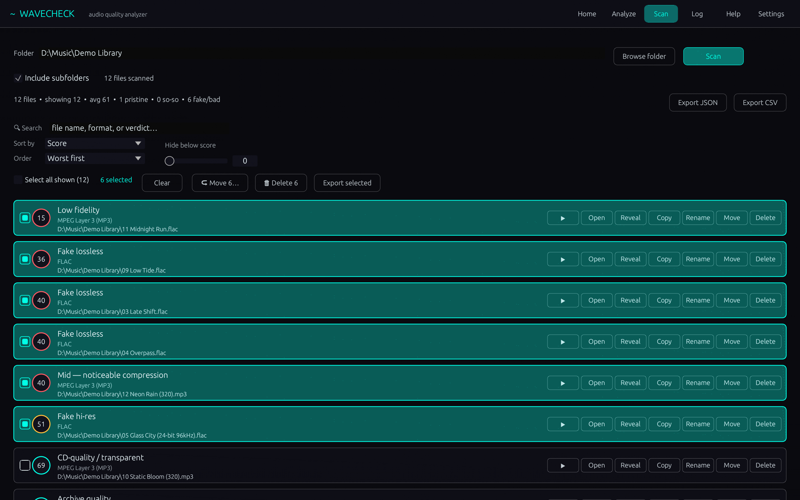
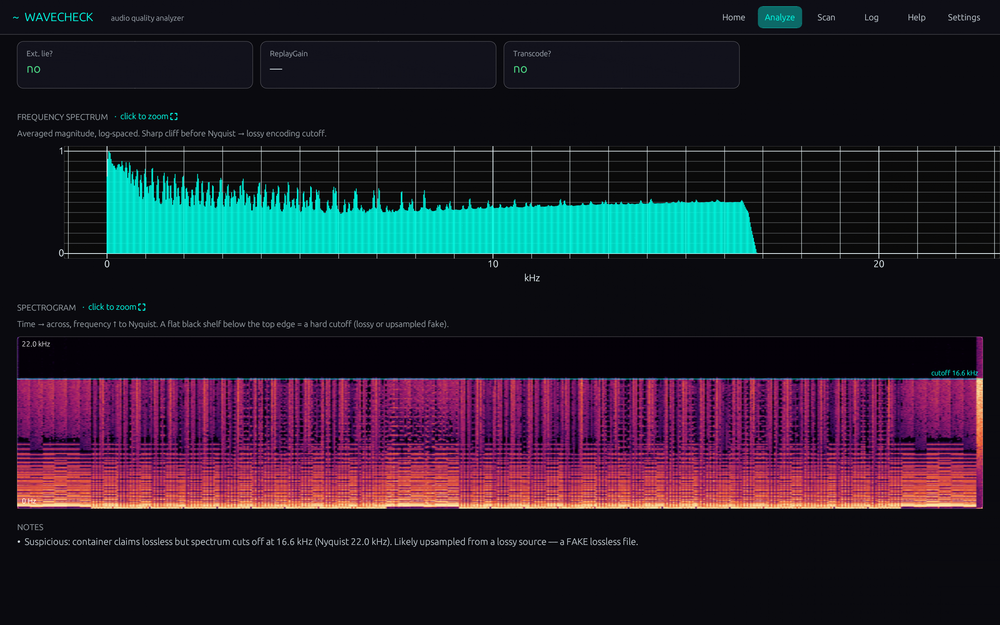
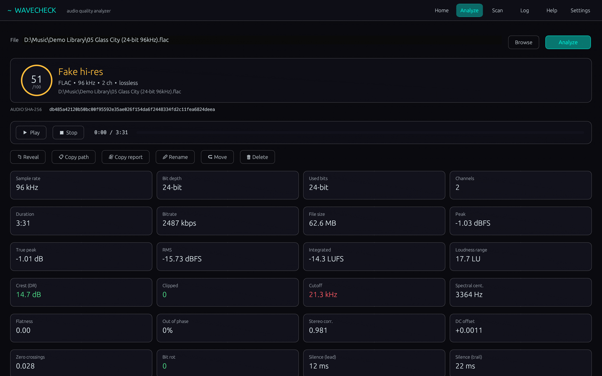
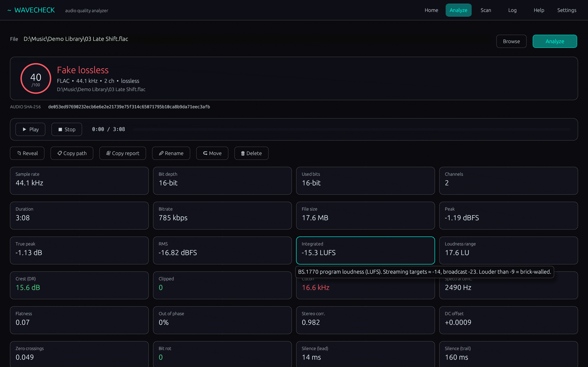
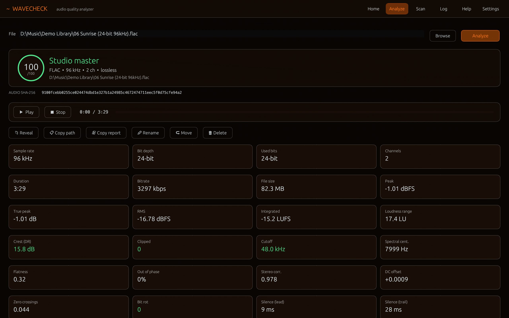
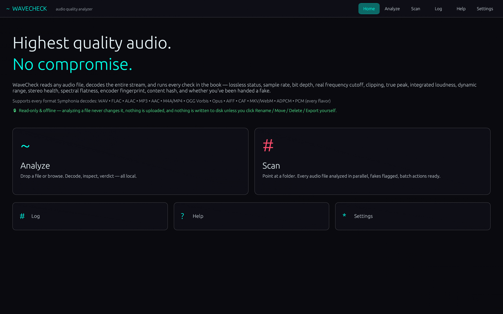

**WaveCheck 1.0.7** for Windows 10/11 (x64) · Free for personal use

### What's new

- Encoder names no longer end in an empty box when the file's tag ends in a hidden zero character
- The English text now uses American spelling everywhere

### Screenshots

 
  
  
  

### Download

**`WaveCheck-Setup-1.0.7.exe`** is attached below. It is the same file as on [tapatch.com/tools/wavecheck](https://tapatch.com/tools/wavecheck/).

### Security

- VirusTotal: **1 / 70** engines flag it · [view report](https://www.virustotal.com/gui/file/13c9d8f86f5769eeb3a50d541d96db3acc1d025ffe2f6613558fa9b2f8f65703/detection)
- SHA-256: `13c9d8f86f5769eeb3a50d541d96db3acc1d025ffe2f6613558fa9b2f8f65703`

*First released on tapatch.com on 2026-11-07.*

---
Free for personal use. Business or commercial use requires a paid license (see [tapatch.com/terms](https://tapatch.com/terms/)).
